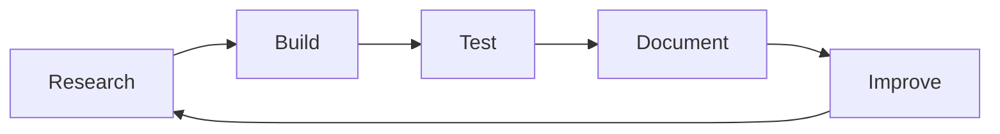

# Ahmad Choirudin

### AI Trainer · Data Annotator · Web3 Researcher · Frontend & Smart Contract Builder

Making AI systems better through data work, and building on-chain with Solidity and Rust.

[Portfolio](https://ahmadchoirudin.my.id/) · [LinkedIn](https://linkedin.com/in/ahmadchoirudin) · [X](https://x.com/CubbieOG) · [Telegram](https://t.me/CubbieOG)

---

## About Me

I work at the intersection of **AI data quality, Web3, and software development**. By day I help improve language models through careful evaluation and annotation. The rest of the time I build frontends and write smart contracts, and I like to ship small projects with tests and documentation instead of leaving them half-finished.

- **AI:** LLM evaluation, data annotation, and Indonesian-language quality review.
- **Web3:** Ecosystem research, crypto and airdrop research, and community operations.
- **Build:** React, TypeScript, Tailwind CSS, Solidity, and Rust.
- **Now:** Smart contract security patterns and Solana programs in Rust.

## Tech Stack & Tools

  
  
  
  
  
  
  
  
  
  
  
  

## Focus Areas

<table>
  <tr>
    <td align="center" width="33%">
      <h3>🧠 AI Quality</h3>
      Evaluating and annotating data so language models give clearer, safer, and more useful answers.
    </td>
    <td align="center" width="33%">
      <h3>⛓️ Web3</h3>
      Researching ecosystems, tokenomics, and on-chain trends, then turning notes into usable insight.
    </td>
    <td align="center" width="33%">
      <h3>🎨 Frontend</h3>
      Building clean, responsive interfaces with React, TypeScript, and Tailwind CSS.
    </td>
  </tr>
</table>

## How I Work

- **Clear over clever.** Simple solutions that other people can read and maintain.
- **Tested before shipped.** If it can be checked, I check it.
- **Honest documentation.** I write down what a project does, and what it does not.

## AI & Digital Work

| Area | What I do |
| --- | --- |
| **LLM evaluation** | Compare and rate model responses for accuracy, helpfulness, safety, and instruction-following, with clear written reasoning. |
| **Data annotation** | Label and review datasets against detailed guidelines, with attention to consistency and edge cases. |
| **Language quality** | Review Indonesian-language content for fluency, tone, and cultural fit. |
| **Web3 research** | Track ecosystems, projects, tokenomics, and airdrop opportunities, and turn the notes into usable summaries. |
| **Community & content** | Moderate online communities and write clear, practical content. |
| **AI-assisted building** | Use AI tools to draft, review, and test code, then verify everything myself before shipping. |

## Currently Exploring

- **Solana programs in Rust:** accounts, signer checks, PDAs, and Borsh serialization.
- **Smart contract security:** reentrancy, access control, checked math, and safe token handling.
- **Testing and CI:** Hardhat tests, `cargo test`, and GitHub Actions on every push.
- **Better AI evaluation:** writing sharper rubrics and spotting failure modes in model output.

## GitHub Activity

## Connect

- **Portfolio:** https://ahmadchoirudin.my.id/
- **LinkedIn:** https://linkedin.com/in/ahmadchoirudin
- **GitHub:** https://github.com/ahmad-choirudin
- **X:** https://x.com/CubbieOG
- **Telegram:** https://t.me/CubbieOG

---

*Learn continuously. Build thoughtfully. Stay curious.*

